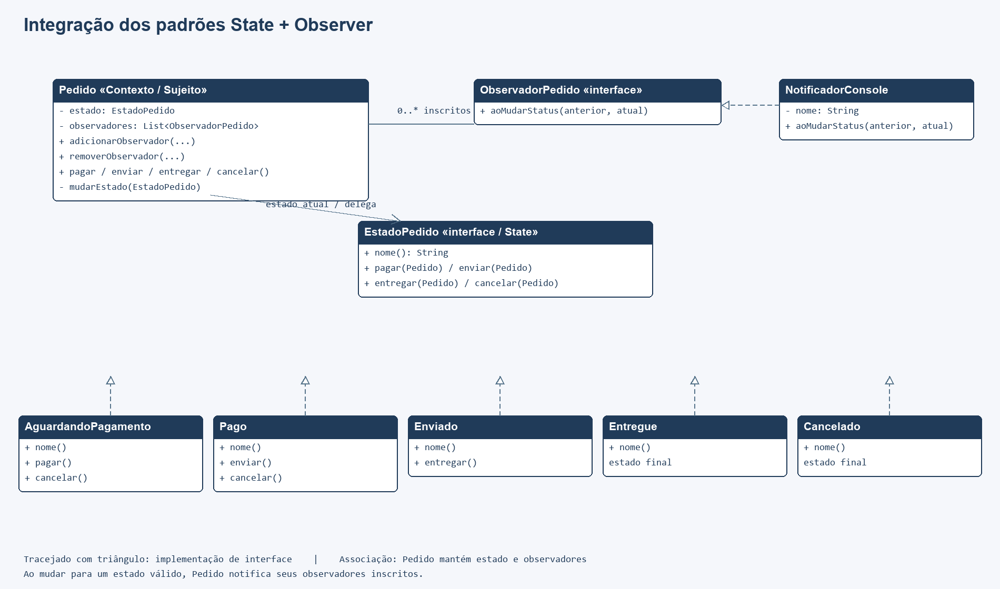

# Integração dos padrões State e Observer em Java

Aplicação de console para acompanhar o ciclo de um pedido. O padrão **State** define quais operações são válidas conforme o status atual. O padrão **Observer** avisa clientes inscritos sempre que o status muda.

## Executar

Requer JDK 8 ou superior; não há dependências externas. Na raiz:

```sh
mkdir out
javac -encoding UTF-8 -d out src/*.java tests/*.java
java -cp out Main
java -cp out StateObserverTest
```

Se a pasta `out` já existir, pule o `mkdir`. O teste usa verificações explícitas: falhas lançam `AssertionError` e retornam código de erro.

## Como os padrões trabalham juntos

`Pedido` delega as ações ao `EstadoPedido` atual. Cada implementação concreta de estado (`AguardandoPagamento`, `Pago`, `Enviado`, `Entregue` e `Cancelado`) aceita transições específicas. Quando uma transição válida ocorre, o contexto atualiza o estado e notifica cada `ObservadorPedido` inscrito. Ações inválidas lançam `IllegalStateException`, não alteram o status e não disparam notificações.

`NotificadorConsole` é um observador concreto de demonstração. O exemplo registra um cliente e o painel da loja. A lista de observadores é própria de cada pedido; observadores podem ser adicionados e removidos.

## Participantes

| Padrão | Papel | Tipo |
| --- | --- | --- |
| State | Contexto | `Pedido` |
| State | Interface e estados concretos | `EstadoPedido`, `AguardandoPagamento`, `Pago`, `Enviado`, `Entregue`, `Cancelado` |
| Observer | Sujeito observado | `Pedido` |
| Observer | Interface de observador | `ObservadorPedido` |
| Observer | Observador concreto | `NotificadorConsole` |
| Cliente | Inicialização da demonstração | `Main` |

## Transições

| Estado atual | Operação | Próximo estado |
| --- | --- | --- |
| Aguardando pagamento | pagar | Pago |
| Aguardando pagamento | cancelar | Cancelado |
| Pago | enviar | Enviado |
| Pago | cancelar | Cancelado |
| Enviado | entregar | Entregue |

`Entregue` e `Cancelado` são estados finais.

## Diagrama de classes



Fonte editável: [diagrama.mmd](docs/diagrama.mmd).

## Testes

`tests/StateObserverTest.java` verifica transições válidas, rejeição de operações inválidas, notificações para vários observadores, não notificação em falhas, remoção de observadores e independência entre pedidos.

As mudanças de status são mantidas em memória. O pagamento é apenas uma transição de exemplo e não realiza cobrança ou estorno.
